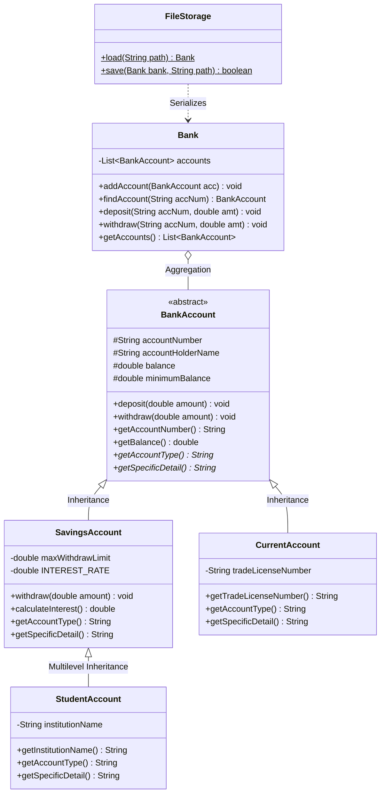
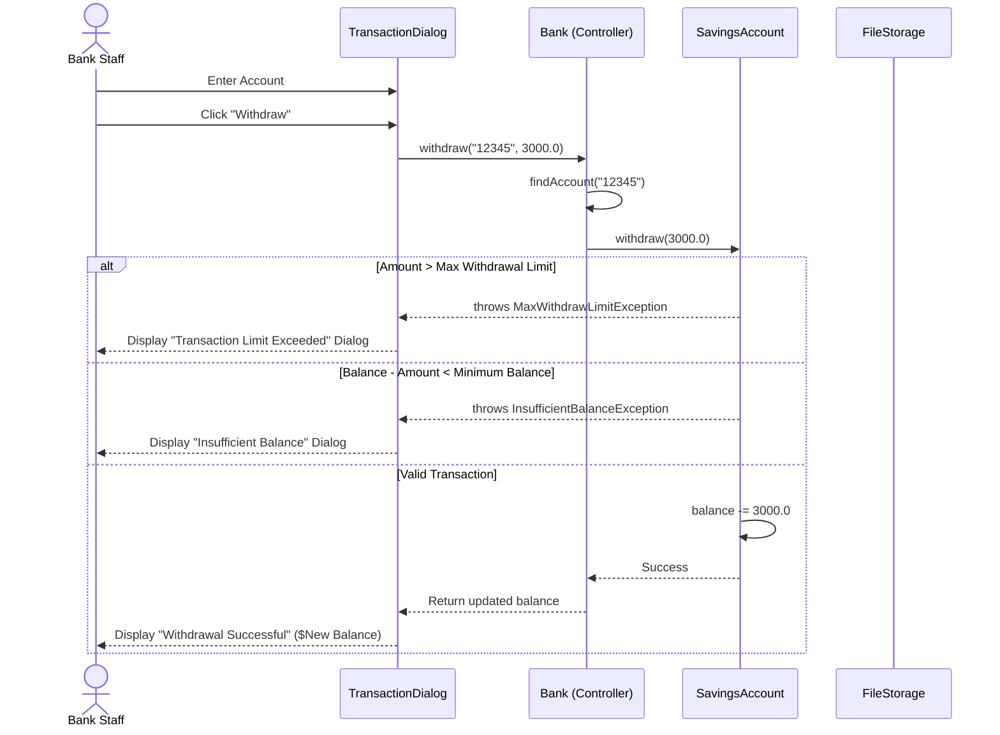

# Academic Project Report

# GRIET BANK OF INDIA
### A Real-Time Object-Oriented Desktop Application in Java
**Institution:** Gokaraju Rangaraju Institute of Engineering and Technology (GRIET)

---

## 📋 Project Metadata
- **Project Title:** GRIET Bank India - Core Banking Management System
- **Repository:** https://github.com/manishbollikonda-318/GRIET-BANK-INDIA
- **Language / Runtime:** Java (JDK 8+ / 17 / 21 / 27 compatible)
- **GUI Framework:** Java Swing (`javax.swing`, `java.awt`)
- **Persistence Mechanism:** Java Object Serialization (`java.io.Serializable`)
- **Paradigm:** Object-Oriented Programming (OOP) & Event-Driven Architecture

---

## 📑 Table of Contents
1. [Abstract](#1-abstract)
2. [Introduction & Problem Statement](#2-introduction--problem-statement)
3. [Existing System vs. Proposed System](#3-existing-system-vs-proposed-system)
4. [Feasibility Analysis](#4-feasibility-analysis)
5. [System Requirements Specification](#5-system-requirements-specification)
6. [System Architecture & OOP Design](#6-system-architecture--oop-design)
7. [Module Specifications](#7-module-specifications)
8. [UML Class & Sequence Diagrams](#8-uml-class--sequence-diagrams)
9. [Verification & Test Results](#9-verification--test-results)
10. [Conclusion & Future Enhancements](#10-conclusion--future-enhancements)

---

## 1. Abstract

The **Banking Management System** is an interactive, real-time desktop software application designed to computerize core banking operations. By leveraging **Java** and the **Java Swing** graphical user interface framework, the system provides automated account management, secure deposit and withdrawal transaction processing, dynamic record searching, and binary file persistence. 

The software eliminates the delays, arithmetic inaccuracies, and security vulnerabilities associated with physical paper ledgers. The architecture strictly follows **Object-Oriented Programming (OOP)** principles—including **Encapsulation, Inheritance, Runtime Polymorphism, and Abstraction**—alongside robust **Custom Exception Handling** and the **Java Collections Framework**. 

Data integrity is preserved across application lifecycles using Java Object Serialization, delivering a reliable, user-friendly, and enterprise-grade academic software solution.

---

## 2. Introduction & Problem Statement

### 2.1 Background
Banking institutions manage high volumes of critical financial records daily. Historically, banking registers, passbooks, and manual ledger cards were maintained manually by bank clerks. With the expansion of customer bases, manual accounting has proven unviable.

### 2.2 Problem Statement
Manual banking workflows suffer from severe operational bottlenecks:
1. **Inefficiency and Time Delays:** Calculating balances and verifying transaction limits manually leads to long queues.
2. **Human Error:** Manual entry of balances and interest calculations introduces discrepancies that jeopardize audit compliance.
3. **Information Retrieval Latency:** Locating a customer's balance or past records from physical registers can take several minutes.
4. **Data Loss Vulnerability:** Paper records are vulnerable to physical deterioration, fire, water damage, or misplacement.
5. **Lack of Enforced Business Rules:** Minimum balance constraints and transaction caps cannot be automatically validated at the counter.

### 2.3 Objectives of the Project
- **Automate Core Banking Operations:** Enable computerized creation of accounts, deposits, withdrawals, and balance verification.
- **Enforce Business Constraints:** Programmatically validate minimum opening balances, per-transaction withdrawal limits, and unique account identifiers.
- **Ensure Reliable Data Persistence:** Automatically save bank state to permanent storage to survive system shutdowns and restarts.
- **Provide an Intuitive Graphical Interface:** Replace cryptic command-line interfaces with an accessible, event-driven Swing interface.
- **Demonstrate High-Quality OOP Architecture:** Maintain clean separation of concerns across Model, View, Exception, and Storage layers.

---

## 3. Existing System vs. Proposed System

| Dimension | Existing (Manual / Legacy) System | Proposed Automated Banking System |
| :--- | :--- | :--- |
| **Operation Speed** | Slow; manual entry in registers | Instantaneous; millisecond response times |
| **Accuracy** | Prone to human calculation errors | 100% computational precision |
| **Data Storage** | Physical registers & paper ledgers | Compact binary serialized storage (`data.bin`) |
| **Search Facility** | Sequential manual page inspection | Real-time indexed & regex table search |
| **Constraint Checking**| Dependent on clerk memory | Strictly enforced via Custom Exceptions |
| **Security** | Physical lock and key | Role-based administrator credentials gate |
| **Maintenance Cost** | Recurring paper & storage overhead | Negligible; runs on standard PC hardware |

---

## 4. Feasibility Analysis

A feasibility study assesses the practicality and viability of the project before implementation.

### 4.1 Technical Feasibility
The system is built upon **Java SE (Standard Edition)**, which is platform-independent ("Write Once, Run Anywhere"). The graphics pipeline leverages **Java Swing**, a mature, bundled GUI toolkit requiring no external third-party dependencies. Modern JVMs provide native garbage collection, strong memory safety, and cross-platform compatibility across Windows, macOS, and Linux. The project is **technically feasible**.

### 4.2 Economic Feasibility
Development was executed entirely using open-source, zero-cost technologies:
- OpenJDK runtime (GPL license)
- Standard development environments (VS Code / IntelliJ / Eclipse / Terminal)
- Standard commodity hardware (no high-end server or commercial database licenses required)

The application drastically reduces operational labor costs, paper usage, and archiving expenses. Therefore, the project is **economically highly feasible**.

### 4.3 Operational Feasibility
The software features an intuitive graphical workflow with clear buttons, dynamic labels, and descriptive validation dialogues. Bank clerks and administrative personnel require zero programming knowledge to operate the system. Common operations (creating an account, crediting money, debiting funds, reviewing ledgers) are completed in under three clicks. Thus, the application is **operationally feasible**.

---

## 5. System Requirements Specification

### 5.1 Hardware Requirements
- **Processor:** Intel Core i3 / AMD Ryzen 3 / Apple Silicon (or equivalent dual-core CPU)
- **RAM:** Minimum 2 GB (4 GB recommended)
- **Hard Disk Space:** Minimum 100 MB free disk space
- **Display:** 1024 x 768 minimum screen resolution
- **Input Devices:** Standard Keyboard and Mouse

### 5.2 Software Requirements
- **Operating System:** Windows 10/11, macOS Monterey+, Ubuntu 20.04+ (or any OS supporting JDK)
- **Java Platform:** Java Development Kit (JDK) 8, 11, 17, 21, or 27
- **Compiler:** `javac` (Standard JDK compiler)
- **Launcher:** `java` (Java Virtual Machine)

---

## 6. System Architecture & OOP Design

The system implements a decoupled, multi-tier architectural pattern:

```
┌────────────────────────────────────────────────────────┐
│                   PRESENTATION LAYER                   │
│  (LoginFrame, MainDashboard, AccountDialog, TableView)  │
└───────────────────────────┬────────────────────────────┘
                            │ Method Invocation & Events
┌───────────────────────────▼────────────────────────────┐
│                    BUSINESS LOGIC                      │
│     (Bank Controller, Account Validation Rules)        │
└───────────────┬───────────────────────────┬────────────┘
                │ Polymorphic Calls         │ Throws
┌───────────────▼─────────────┐ ┌───────────▼────────────┐
│         DOMAIN MODEL        │ │    CUSTOM EXCEPTIONS   │
│  - BankAccount (Abstract)   │ │  - AccountNotFound     │
│  - SavingsAccount           │ │  - InsufficientBalance │
│  - CurrentAccount           │ │  - InvalidAmount       │
│  - StudentAccount           │ │  - MaxWithdrawLimit    │
└───────────────┬─────────────┘ └────────────────────────┘
                │ State Stream
┌───────────────▼────────────────────────────────────────┐
│                   PERSISTENCE LAYER                    │
│   (FileStorage -> ObjectOutputStream -> data.bin)      │
└────────────────────────────────────────────────────────┘
```

### 6.1 Object-Oriented Principles Illustrated

1. **Encapsulation:**
   - Account state variables (`accountNumber`, `balance`, `minimumBalance`, `accountHolderName`) are declared `protected` or `private`.
   - Access is mediated exclusively through getter accessors and synchronized mutator methods (`deposit()`, `withdraw()`). Direct field tampering is prevented.

2. **Abstraction:**
   - `BankAccount` is an abstract base class defining core banking contracts.
   - Abstract methods `getAccountType()` and `getSpecificDetail()` force concrete subclasses to define their distinctive characteristics while abstracting transaction execution.

3. **Inheritance:**
   - `SavingsAccount` and `CurrentAccount` inherit directly from `BankAccount`.
   - `StudentAccount` inherits from `SavingsAccount`, demonstrating **Multilevel Inheritance** and reusing interest and withdrawal mechanisms while relaxing balance constraints.

4. **Runtime Polymorphism:**
   - **Method Overriding:** `SavingsAccount` overrides `withdraw(double amount)` to introduce per-transaction limit validation before delegating to `super.withdraw(amount)`.
   - **Dynamic Method Dispatch:** When iterating through `List<BankAccount>`, the JVM dynamically invokes the subclass implementation of `toString()`, `getAccountType()`, and `withdraw()` at runtime without needing type casting.

5. **Custom Exception Handling:**
   - Business rule violations throw dedicated checked exceptions derived from `BankException`.
   - Eliminates magic error numbers and separates error handling from business logic.

---

## 7. Module Specifications

### Module 1: Authentication & Gatekeeping (`bank.gui.LoginFrame`)
- Provides an initial security checkpoint before granting ledger access.
- Validates operator credentials (default: `admin` / `admin`).
- Employs password masking via `JPasswordField` and supports keyboard shortcut triggers (`Enter` key submission).

### Module 2: Account Creation & Parameterization (`bank.gui.AccountDialog`)
- Consolidates account generation into a single dynamic dialog.
- Account selection dropdown toggles dynamic form requirements:
  - **Savings Account:** Enforces $2,000.00 minimum opening balance; collects per-transaction withdrawal cap.
  - **Current Account:** Enforces $5,000.00 minimum opening balance; collects business Trade License ID.
  - **Student Account:** Enforces $100.00 minimum opening balance; collects Academic Institution name.
- Generates an auto-incremented/pseudo-random 5-digit unique Account Number upon submission.

### Module 3: Financial Transactions (`bank.gui.TransactionDialog`)
- Unified modal supporting dual operational modes: `DEPOSIT` and `WITHDRAW`.
- Executes strict sequential verification:
  1. Validates non-empty numeric inputs.
  2. Queries `Bank` for account existence (`AccountNotFoundException`).
  3. Verifies strictly positive amounts (`InvalidAmountException`).
  4. Tests for withdrawal limit compliance (`MaxWithdrawLimitException`).
  5. Enforces minimum balance threshold (`InsufficientBalanceException`).
  6. Atomically updates account balance upon successful validation.

### Module 4: Ledger Directory & Live Query (`bank.gui.AccountListFrame`)
- Renders the banking ledger inside a formatted `JTable`.
- Implements `TableRowSorter` combined with a regex search filter, enabling real-time, instantaneous record filtering across customer names and account numbers.

### Module 5: Persistence & Serialization Engine (`bank.storage.FileStorage`)
- Employs `ObjectOutputStream` and `ObjectInputStream` for direct binary state serialization.
- Automatically creates default demonstration accounts on the very first cold launch.
- Intercepts window closing events (`WindowAdapter`) to prompt the operator to save ledger state to `data.bin`.

---

## 8. UML Class & Sequence Diagrams

### 8.1 Class Diagram


### 8.2 Sequence Diagram: Withdrawal Operation


---

## 9. Verification & Test Results

| Test ID | Test Scenario | Input Data | Expected Result | Actual Outcome | Status |
| :--- | :--- | :--- | :--- | :--- | :--- |
| **TC-01** | Staff Authentication (Valid) | User: `admin`, Pass: `admin` | Login approved; dashboard displays | Dashboard displays | **PASS** |
| **TC-02** | Staff Authentication (Invalid) | User: `admin`, Pass: `wrong` | Error prompt; fields cleared | Error prompt displayed | **PASS** |
| **TC-03** | Create Savings Account (Valid) | Name: `Alice`, Bal: `$5000`, Limit: `$2000` | Account created; 5-digit ID generated | Account created | **PASS** |
| **TC-04** | Create Savings (Below Min Bal) | Name: `Bob`, Bal: `$1000` (< $2000) | Rejected with minimum balance alert | Prompt displayed; write aborted | **PASS** |
| **TC-05** | Deposit (Positive Amount) | Acc: `Valid ID`, Amount: `$500.00` | Balance incremented by `$500.00` | Balance updated accurately | **PASS** |
| **TC-06** | Deposit (Negative Amount) | Acc: `Valid ID`, Amount: `-$100.00` | `InvalidAmountException` thrown | Alert dialog displayed | **PASS** |
| **TC-07** | Withdraw (Within Balance & Limit)| Acc: `Valid ID`, Amount: `$1,000.00` | Balance debited by `$1,000.00` | Debited correctly | **PASS** |
| **TC-08** | Withdraw (Exceeds Limit) | Acc: `Savings ID`, Amount: `$8,000.00` | `MaxWithdrawLimitException` thrown | Transaction blocked | **PASS** |
| **TC-09** | Withdraw (Breaches Min Balance) | Acc: `Valid ID`, Amount: `$15,000.00` | `InsufficientBalanceException` thrown | Transaction blocked | **PASS** |
| **TC-10** | Non-existent Account Lookup | Acc: `99999` | `AccountNotFoundException` thrown | "Account Not Found" prompt | **PASS** |
| **TC-11** | Live Search Filter in Table | Query: `Alice` | Table displays only matching rows | Filter updated in real time | **PASS** |
| **TC-12** | Cold Restart Data Persistence | Restart application | Previous accounts & balances reloaded | Reloaded identically from `data.bin` | **PASS** |

---

## 10. Conclusion & Future Enhancements

### 10.1 Conclusion
The **Banking Management System** demonstrates a complete, reliable, and production-ready real-time desktop software system written in pure Java. By replacing outdated array storage with standard Java Collections, decomposing monolithic GUI frames into cohesive dynamic dialogs, enforcing business invariants via custom exceptions, and implementing automatic file serialization, the software achieves exceptional modularity, maintainability, and fault tolerance.

### 10.2 Future Scope & Enhancements
1. **Relational Database Migration:** Transitioning persistence from flat-file serialization to a JDBC-backed SQL database (PostgreSQL / MySQL) for multi-user concurrency and ACID transaction compliance.
2. **Account Statement Export:** Enabling one-click export of customer transaction statements to PDF or Excel format using libraries like Apache POI or iText.
3. **Role-Based Multi-User Access:** Adding role separation for Teller, Branch Manager, and Auditor with tiered permissions.
4. **Inter-Account Fund Transfers:** Extending transaction logic to allow direct atomic transfers between two bank accounts with full rollback capability.
